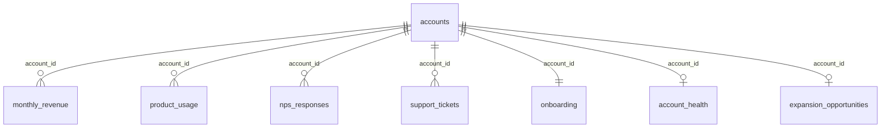

# Customer Success Analytics Dashboard

**SQL · Excel · Power BI** — a 5-page SaaS Customer Success dashboard built on 2,600 customer accounts (Jan 2024 – Sep 2026), with a customer health score that flags accounts likely to churn.

> **Data note:** the dataset is synthetic. It was generated to behave like real CRM, billing, product-usage, survey and helpdesk data (`scripts/generate_data.py`), so no real company or customer is represented.

---

## Business questions

1. How healthy is recurring revenue (ARR, MRR, growth, retention)?
2. Who is churning, and why?
3. Which active customers are at risk, and which renewals need attention first?
4. Where can we grow existing customers?

## Key findings (reporting month: Sep 2026)

| Metric | Value |
| --- | --- |
| ARR / MRR | $75.6M / $6.30M |
| Active customers | 2,121 of 2,600 ever signed |
| MRR growth, last 12 months | +38.8% |
| Net revenue retention (NRR) | 92.3% |
| Gross revenue retention (GRR) | 87.8% |
| NPS, last 12 months | 27 |
| Health tiers | 1,102 Healthy · 901 Needs Attention · 118 High Risk |
| ARR in High Risk tier | $5.7M |
| Unhealthy renewals before Mar 2027 | 171 accounts, $7.6M ARR |
| Expansion pipeline | 344 accounts, about $4.1M added ARR |

- **Usage drops before churn.** Churned customers used 33% of their paid seats in their last 3 months, against 74% for active customers.
- **Late onboarding doubles churn:** 34.5% of late-onboarded customers churned, against 17.1% of on-time ones.
- **Low adoption is the top churn reason** (32.6% of churned customers).
- **Plan type does not predict churn** (17.7%–19.2% across plans), but segment does: Mid-Market 22.1% vs Enterprise 11.4%.
- **The health score works.** Scored as of Sep 2025, 42.7% of High Risk accounts churned within 12 months, against 6.3% of Healthy accounts (about 7x).
- **NRR below 100%** means churn outweighs expansion; growth currently depends on new customers.

## Dashboard pages

| Page | Question | Highlights |
| --- | --- | --- |
| 1. Executive Overview | How healthy is the business? | ARR, MRR, customers, NRR, GRR, NPS · MRR trend · health tiers · ARR by segment |
| 2. Revenue Performance | Where does revenue come from and go? | New / expansion / contraction / churned MRR by month · ARR by region × plan |
| 3. Churn & Retention | Who is leaving, and why? | Logo churn trend · churn reasons · churn by onboarding outcome and segment |
| 4. Customer Health & Engagement | Who will leave next? | Usage vs health scatter · High Risk accounts by CSM · at-risk renewals list |
| 5. Growth Opportunities | Where can we grow? | Expansion pipeline by type · NPS by segment · top expansion accounts |

Every page has Segment, Region and Plan slicers.

<!-- Screenshots: after adding the 5 PNGs to screenshots/, delete this comment line and the closing one below.


-->

## Customer health score

Each active customer gets five component scores (0–100), combined into one weighted score.

| Component | Weight | Rule |
| --- | --- | --- |
| Product usage | 35% | Seat utilisation over the last 3 months; 90%+ scores 100 |
| NPS | 20% | Latest score × 10; no survey yet = 50 |
| Support load | 15% | Tickets in last 90 days: 0–1 = 100, 2–3 = 75, 4–6 = 50, 7+ = 20 |
| Onboarding | 10% | On time = 100, late = 60, in progress = 50 |
| Revenue trend | 20% | MRR vs 3 months ago: up = 100, flat = 70, down = 30 |

Tiers: **Healthy** 80+, **Needs Attention** 65–79, **High Risk** below 65. Full method and backtest: [docs/health_score_methodology.md](docs/health_score_methodology.md).

## Data model



`accounts` holds one row per customer; the other tables hold monthly, survey or ticket rows. `account_health` and `expansion_opportunities` are produced by the SQL in `sql/`. Column descriptions: [docs/data_dictionary.md](docs/data_dictionary.md). Every query's output: [docs/sql_results.md](docs/sql_results.md).

## Tools and techniques

- **SQL (SQLite / MySQL / PostgreSQL):** data quality checks, `GROUP BY` with conditional aggregation, `JOIN`s, CTEs, window functions (`LAG`, `ROW_NUMBER`), and a view for the health score.
- **Excel:** a one-page dashboard (6 KPI tiles, 8 charts) plus the health score rebuilt with live formulas (`SUMIFS`, `COUNTIFS`, `INDEX`, nested `IF`) and editable weights. Every number recalculates from the data tabs.
- **Power BI:** star-schema model with 7 relationships, 42 DAX measures (MRR movements, NRR, GRR, logo churn, NPS, health and pipeline), 5 report pages and a custom theme.

DAX measure list: [docs/dax_measures.md](docs/dax_measures.md).

## Repository structure

```text
data/                 8 CSV files (6 raw tables + 2 produced by SQL)
sql/                  customer_success_analysis.sql — all queries, in order
                      backtest_health_score.sql — health score validation
excel/                Customer_Success_Analytics.xlsx — formula-driven model
powerbi/              CS Analytics.pbip — Power BI project (model + 5-page report)
  browser-scripts/    TMDL scripts to rebuild the model in the Power BI web editor
docs/                 data dictionary, health score method, DAX measures, SQL results
screenshots/          dashboard page images
scripts/              generate_data.py — recreates the dataset (seed 42)
```

## How to run it

**SQL:** load the 6 raw CSVs into a database (for example DB Browser for SQLite) using the file names as table names, then run `sql/customer_success_analysis.sql` section by section.

**Excel:** open `excel/Customer_Success_Analytics.xlsx`; the `Dashboard` tab opens first. Change the blue cells on the `Assumptions` tab to test different health-score weights.

**Power BI Desktop (Windows):**

1. Open `powerbi/CS Analytics.pbip`.
2. Go to **Transform data → Edit parameters** and set `DataFolder` to the full path of this repo's `data` folder, ending with `\`.
3. Click **Refresh**.

---

*Abhishek Panjabi · [abhishekpanjabi21@gmail.com](mailto:abhishekpanjabi21@gmail.com)*
